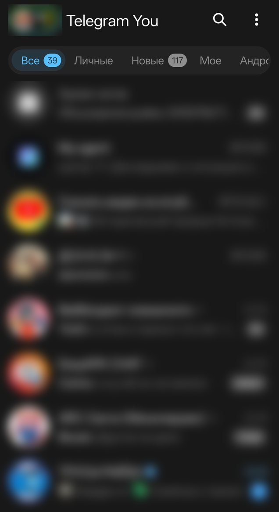
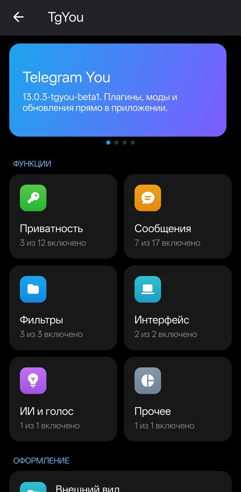
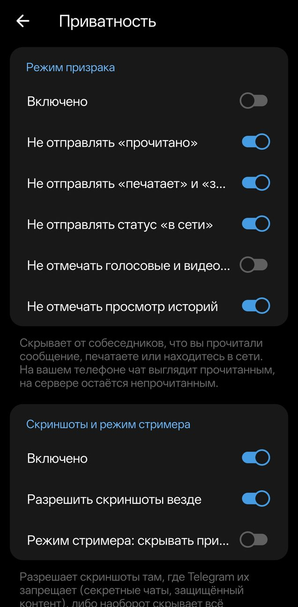

<div align="center">


# Telegram You

**Клиент Telegram для Android, который настраивается под вас.**<br>
Всё — плагины: встроенные на Java, внешние на Python. Функции AyuGram и exteraGram, моды, наборы иконок, маркетплейс.

[Скачать](https://github.com/Gl1ch5/TgYou/releases) · [Сайт](http://64.188.66.249:8090) · [Документация](docs/README.md) · [Маркетплейс модов](https://grzxk.ru/tgyou/)

`com.tgyou.app` · на базе [DrKLO/Telegram](https://github.com/DrKLO/Telegram) 13.0.3 · GPL v2 · arm64-v8a

</div>

---

## Скриншоты

<table>
  <tr>
    <td align="center" width="33%"><br><sub>Список чатов: папки со счётчиками, Pill Stack в поиске</sub></td>
    <td align="center" width="33%"><br><sub>Главный экран «Telegram You»</sub></td>
    <td align="center" width="33%"><br><sub>Режим Призрака и приватность</sub></td>
  </tr>
</table>

> Чаты на скриншоте размыты намеренно. Статус проверки каждой функции — в [документации](docs/README.md): большая часть написана и компилируется, но ещё не проверена на устройстве (см. раздел «Честный статус»).

---

## Что умеет

### Приватность
- **Режим Призрака** — главный переключатель с пятью опциями: не читать сообщения, не читать истории, не слать «онлайн», не слать «печатает», автоматический «офлайн». Долгое нажатие на опцию фиксирует её.
- Читать при действиях (ответ или реакция сами помечают чат прочитанным), «отложка» (отправка с задержкой), отправка без звука (никогда / всегда / в режиме призрака), предложение включить призрака перед просмотром истории.
- **Не читать содержимое** (голосовые и кружки остаются непрослушанными), скрытые просмотры постов и историй.
- **Скрывать скриншоты** в секретных чатах, **разрешить скриншоты** там, где Telegram ставит `FLAG_SECURE`, **режим стримера** (приложение скрыто при записи экрана).
- Без телеметрии, без синхронизации контактов, без «частых контактов», облачные черновики отключаются, защита отправленных от пересылки.

### Шпион: сообщения, которые не исчезают
- **Сохранять удалённые** сообщения (с пометкой: значок, текст или цветной кружок на выбор) и **историю правок** (число правок и диалог со всеми версиями).
- Полупрозрачные удалёнки, оформление метки «изменено».
- **Дата чтения** исходящих и **последний онлайн**.
- **Сохранять вложения** удалённых сообщений в отдельную папку с лимитом места.
- **Сохранять чаты после бана или кика**, **сохранять фото и видео с таймером**, **снять запрет копирования** («защита содержимого»).
- Резервная копия базы: экспорт, импорт, очистка.

### Фильтры
- Скрытие сообщений по словам, подстрокам и регулярным выражениям (`re:...`), теневой бан пользователей, только входящие, только личные.
- **Блок рекламы** (спонсорские сообщения в чатах и в поиске), скрывать заблокированных.

### Чаты
- Размер текста и стикеров, скрывать клавиатуру при прокрутке, запятая после упоминания, скрыть «Отправить как…» и приветственный стикер.
- **Ответы**: без подсветки, без цитаты, упоминание автора.
- **Широкие посты** в каналах и ленте.
- **ИИ-функции**: распознавание голосовых (Whisper на Groq, свой ключ), краткие сводки и Instant View, редактор.
- **Быстрые админ-действия**: удалить и забанить, заглушить на 1 час, день, неделю или навсегда.
- **Свайп** для ответа или в Избранное, **двойное касание** с выбором действия (реакция, ответ, избранное, копирование, правка).
- **Результаты вычислений**: `2+2=` превращается в `2+2= 4`.
- Умная типографика (тире, многоточие, «ёлочки»), «Время с секундами», ID и данные кнопок, подробности сообщения, цитата, поиск в Google.
- Профиль: ID и дата-центр, ID чатов и каналов в формате Bot API; значок разработчика.

### Внешний вид
- **Pill Stack** — таблетка в строке поиска, листается нажатием: время, дата, заряд, память, **погода** (публичные API Open-Meteo и ipwho.is, без ключа), прокси, **пинг прокси**, режим призрака. Адаптивная ширина, тема светлая и тёмная.
- **Material Design 3**: тональные панель ввода, пузыри, шапка, фон; радиус пузырей, без разделителей.
- Живая прозрачность и скругление пузырей, размер текста, предпросмотр, быстрая перезагрузка интерфейса без перезапуска.
- Скругление аватаров, **мини-аватарки отправителей** в списке чатов, заголовок по центру, поиск без отступа.
- **Папки**: стиль заголовков (эмодзи или текст), счётчики, скрыть «Все чаты».
- Жидкое стекло (Liquid Glass), стеклянное меню, принудительное размытие, снег, системные эмодзи и шрифты, пользовательские шрифты.
- Разные темы в чатах (или их игнорирование), липкая анимация аватара профиля.
- **Наборы иконок `.icons`** (формат exteraGram): установка по тапу, плитки, предпросмотр, 800+ иконок подменяется на лету. Своя иконка приложения и «тематические значки» Android.
- Подсказка при вводе кода: каким способом пришёл код и как запросить заново.

### Основные
Округление чисел, вибрация, задержка уведомлений, Zalgo, скорость загрузки и отправки, папка сохранения, относительный онлайн, скрытие номера телефона, архив (скрыть, открыть подтягиванием), «Не переводить», работа в фоне (исключение из оптимизации батареи).

### Плагины и моды
- **Всё — плагины**: встроенные на Java (`com.tgyou.plugins`) и внешние на **Python** ([Chaquopy](https://chaquo.com/chaquopy/), Python 3.13). Полный доступ к приложению, без песочницы.
- **Моды `.mod`**: установка по тапу из чата или файлового менеджера, вкладки «Маркетплейс», «Установленные», «Создать мод» (SDK для ИИ-агента), кнопки «Журнал» и «Поделиться», карантин после сбоя.
- **Совместимость с плагинами exteraGram** (`.plugin`): настройки, хуки отправки, запросов, ответов и апдейтов, пункты меню сообщения, чата и профиля, `hook_method` на Pine, клиентские утилиты. Проверено статически на 81 реальном плагине.
- **Маркетплейс** модов с проверкой SHA-256 и модерацией: [grzxk.ru/tgyou](https://grzxk.ru/tgyou/).
- Мод **Liquid Glass** из маркетплейса.
- Premium-вид клиента (**локальный Premium**).

### Обновления и сеть
- **Обновление внутри приложения** из релизов GitHub: карточка с changelog, скачивание с процентами, системный установщик.
- Прокси для распознавания голосовых (Groq недоступен из части сетей).

---

## Установка

1. Откройте [релизы](https://github.com/Gl1ch5/TgYou/releases) и скачайте последний `app.apk` (пререлизы `v0.1.0-betaN`).
2. Разрешите установку из неизвестных источников и установите поверх: подпись CI постоянна, данные сохраняются.
3. Войдите в свой аккаунт Telegram.

## Сборка

Нужны собственные `api_id` и `api_hash` с https://my.telegram.org. Они **не хранятся в репозитории**.

```bash
export TG_API_ID=123456
export TG_API_HASH=xxxxxxxxxxxxxxxxxxxxxxxxxxxxxxxx
./gradlew :TMessagesProj_App:assembleAfatRelease
```

Требования: JDK 21, Android SDK (platform 36, build-tools 36.0.0, NDK 27.2.12479018, CMake). Подробнее и про CI — в [AGENTS.md](AGENTS.md).

GitHub Actions: `Build beta` (полная сборка и релиз по запуску с `release_tag`), `Compile check` (только javac, около 4 минут). Нужны секреты `TG_API_ID` и `TG_API_HASH`.

## Как устроено

Код Telegram не переписан: в его файлах стоят только однострочные вызовы `TgYouHooks`, вся логика живёт в `TMessagesProj/src/main/java/com/tgyou/`. Благодаря этому обновления апстрима можно подтягивать без боли.

| Папка | Что внутри |
|---|---|
| `core/` | ядро плагинов, шина хуков, настройки, отдельные модули (Pill Stack, папки, мини-аватарки, стекло, шрифты) |
| `plugins/` | встроенные плагины |
| `ui/` | экраны настроек TgYou, моды, иконки, обновления |
| `mods/`, `icons/`, `update/` | рантайм Python-модов, наборы иконок, обновление |
| `backend/` | сервер маркетплейса (FastAPI + SQLite) |
| `site/` | сайт проекта |

## Честный статус

- Проверено на телефоне: локальный Premium, распознавание голосовых через Whisper, главный экран TgYou с переключателями.
- Остальное написано и **компилируется**, но на устройстве ещё не проверено. Больше всего риска: скрытие «Все чаты», мини-аватарки (сдвиг текста), цвета Material Design 3, центрированный заголовок, Pine-хуки на Android 16, «отложка».
- Подписи экранов сделаны по скриншотам AyuGram.
- Статус каждой функции указан в [docs/](docs/README.md).

## Лицензия и благодарности

Основано на [Telegram for Android](https://github.com/DrKLO/Telegram) (GPL v2, исходный код форка открыт). Функции вдохновлены [AyuGram](https://github.com/AyuGram/AyuGram4A) и [exteraGram](https://github.com/exteraSquad/exteraGram).
